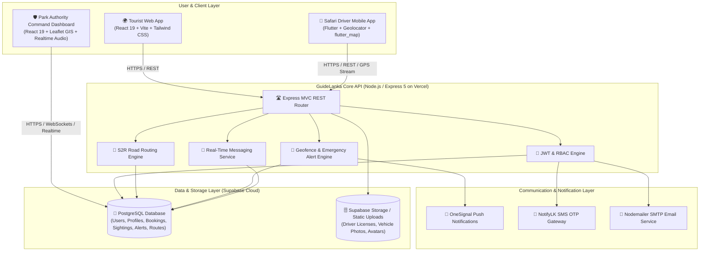

# 🌿 GuideLanka — Smart National Park & Wildlife Safari Management System

<div align="center">

[](https://guide-lanka-backend.vercel.app)
[](https://nodejs.org/)
[](https://expressjs.com/)
[](https://react.dev/)
[](https://flutter.dev/)
[](https://supabase.com/)
[](https://tailwindcss.com/)
[](https://leafletjs.com/)

<p align="center">
  <b>A unified, real-time ecosystem modernizing Sri Lanka's wildlife safari operations.</b><br>
  Connecting Tourists, Safari Drivers, and Department of Wildlife Conservation (DWC) Authorities through real-time GIS tracking, AI-assisted Sightings-to-Route (S2R) road optimization, instant emergency response with click-to-call, and verified bookings.
</p>

[Key Features](#-key-features) •
[Architecture](#-system-architecture) •
[S2R Routing Algorithm](#-s2r-sightings-to-route-algorithm) •
[System Modules](#-system-modules) •
[Quick Start](#-installation--setup-guide) •
[Mobile APK Build](#-mobile-apk-build-guide) •
[API Reference](#-api-endpoints-overview)

---

</div>

## 📖 Overview

National Parks in Sri Lanka (such as **Yala**, **Wilpattu**, **Udawalawe**, and **Minneriya**) host some of the world's highest densities of leopards, Asian elephants, and endemic wildlife. However, traditional safari operations face critical modern challenges:
- **Track Congestion & Animal Disturbance**: Excessive vehicle crowding around sudden wildlife sightings causing stress to animals.
- **Safety & Geofencing**: Safari vehicles accidentally straying into strict nature reserves or restricted core zones.
- **Driver Verification**: Tourists struggle to identify verified, licensed safari guides with standardized pricing.
- **Emergency Dispatch Gaps**: Delays in ranger notification during vehicle breakdowns, medical emergencies, or lost routes.

**GuideLanka** resolves these bottlenecks by combining four synchronized platforms powered by real-time GPS telemetry, push notifications, and multi-objective routing algorithms.

---

## 🏛️ System Architecture



---

## 🧠 S2R (Sightings-to-Route) Algorithm

At the core of the driver navigation engine is the **S2R Algorithm**, designed to maximize visitor sighting utility while strictly minimizing trail congestion and route deviations:

### 1. Species-Specific Time Decay ($TD_i$)
Animals exhibit distinct movement patterns; hence sightings decay at species-tailored rates:

$$TD_i = \max\left(0, 1 - \frac{t_i}{T_{\max}(\text{species})}\right)$$

| Species | Max Lifespan ($T_{\max}$) | Behavioral Rationale | Animal Weight ($AW_i$) |
| :--- | :---: | :--- | :---: |
| 🐘 **Elephant** | **60 mins** | Foraging herds remain in grazing areas longer | `0.70` |
| 🐆 **Leopard** | **30 mins** | Solitary apex predator moving continuously | `1.00` |
| 🐻 **Sloth Bear** | **30 mins** | Solitary omnivore roaming across trails | `0.80` |
| 🦚 **Peacock / Birds** | **20 mins** | High mobility, flight behavior | `0.20` |
| 🦌 **Deer / Sambar** | **15 mins** | Timid herbivores that flee upon disturbance | `0.30` |

### 2. Sighting Utility ($S_i$)
Quantifies the observational value of a sighting based on species rarity, freshness, and reporter reliability ($R_i \approx 0.90$):

$$S_i = AW_i \times TD_i \times R_i$$

### 3. Safari Road Graph Network & Dijkstra Routing
* Road networks are modeled as an interconnected graph $G = (V, E)$ parsed directly from park GeoJSON vector coordinates (such as the comprehensive Yala Block 5 & 6 topology containing over 4,600 nodes).
* Disconnected line segments are dynamically bridged using a 15-meter proximity threshold (`_ensureFullyConnected()`).
* Dijkstra's shortest-path algorithm calculates the optimal curved path along authentic safari trails, preventing unrealistic straight-line vector cuts across topography.

### 4. Overall S2R Route Score ($U_i$)
Calculates composite utility balancing wildlife value against congestion and travel distance:

$$U_i = w_s S_i - w_c C_i - w_d D_i$$

Where:
* $w_s = 0.5$ (Sighting utility weight)
* $w_c = 0.3$ (Congestion penalty weight)
* $w_d = 0.2$ (Normalized road distance weight)

---

## 🚀 System Modules

### 1. 🛡️ Park Authority Command Dashboard (`/authority-dashboard`)
Dedicated interface for park rangers and administrative wardens:
* **Live GIS Tracking Map**: Real-time Leaflet visualization of active safari jeeps, live sightings, park trail networks, and emergency incidents.
* **Safari Road Network**: Interactive GeoJSON road layer rendering authentic Yala Block 5 & 6 tracks with hover highlights and detailed trail inspection tooltips.
* **SOS & Incident Center with Direct Call**:
  * Displays emergency alerts (e.g. `LOST_ROUTE`, `VEHICLE_BREAKDOWN`, `MEDICAL_EMERGENCY`).
  * Shows **Driver Name** and **Mobile Phone Number** with an instant **"Call Now"** button (`tel:` link).
  * 1-click **"View on Maps"** external coordinate locator.
  * Ranger unit dispatch status tracking (`Ranger En Route` ➔ `Resolved`).
* **Geofence Enforcement**: Automated audio and visual warnings when a jeep deviates outside authorized park boundaries.
* **Driver Compliance Review**: Review driver identity documentation, commercial licenses, and vehicle certifications.
* **Analytics & Revenue**: Track park entry commissions, daily active safaris, and visitor volume.

### 2. 📱 Safari Driver Mobile App (`/driver_mobile`)
Field application for safari jeep drivers built in Flutter:
* **Live Safari Radar**: Real-time map displaying recent sightings with remaining lifespan countdown badges.
* **Yala Block 5 & 6 Safari Trails**: High-precision road network rendered directly from authentic GeoJSON vector data, calibrated to the active park tracks (`6.540325, 81.305318`).
* **Turn-by-Turn S2R Road Navigation**: Illuminated neon-blue routes that strictly follow safari road curves.
* **Interactive Sighting Logger**: Tap or drag-and-drop marker on the map to pinpoint exact animal sighting locations.
* **Emergency SOS Transmitter**: Broadcasts vehicle GPS coordinates and emergency type directly to ranger control.
* **Geofencing Safety Guard**: Monitors boundary compliance and triggers automated warnings upon park perimeter exit.
* **Driver Earnings & Booking Management**: Accept or decline tourist bookings with live chat coordination.

### 3. 🌍 Tourist Web Experience (`/tourist-web-app`)
Responsive web portal for domestic and international travelers:
* **Wildlife Explorer & Heatmap**: View active animal sightings reported across National Parks.
* **Certified Driver Directory**: Browse verified drivers with ratings, reviews, pricing, languages, and jeep models.
* **Direct Booking System**: Book half-day, full-day, or multi-zone safari excursions.
* **In-App Messaging**: Real-time communication between tourist and assigned safari driver.
* **Park Safety Manual & Guidelines**: Interactive guidelines on park rules, wildlife ethics, and photography dos & don'ts.

### 4. ⚙️ Central Cloud API (`/backend`)
* **Production Deployment**: Hosted on Vercel at [`https://guide-lanka-backend.vercel.app`](https://guide-lanka-backend.vercel.app).
* **RESTful MVC Architecture**: Built with Node.js and Express 5.
* **Database & Auth**: Supabase PostgreSQL with JWT role-based access control (`AUTHORITY`, `DRIVER`, `TOURIST`).
* **Multi-Channel Communications**: SMS OTP verification via NotifyLK, push notifications via OneSignal, and automated emails via Nodemailer.

---

## 📂 Repository Structure

```
GuideLanka/
├── 📁 authority-dashboard/      # React 19 + Vite Authority Management Dashboard
│   ├── 📁 src/
│   │   ├── 📁 assets/           # Yala Block 5 & 6 GeoJSON road network & logos
│   │   ├── 📁 components/       # SOSPanel, LiveMap, DriverReviewList, Sidebar, etc.
│   │   ├── 📁 pages/            # Dashboard, Login
│   │   └── 📁 services/         # Supabase client & API config
│   ├── package.json
│   └── vite.config.js
│
├── 📁 backend/                  # Node.js / Express 5 MVC REST API
│   ├── 📁 src/
│   │   ├── 📁 config/           # Supabase client & environment configuration
│   │   ├── 📁 controllers/      # Auth, Alert, Booking, Driver, Sighting controllers
│   │   ├── 📁 middlewares/      # JWT auth & role validation middlewares
│   │   ├── 📁 routes/           # Express router endpoints
│   │   └── 📁 services/         # S2R routing logic & notifications
│   ├── server.js                # Server entry point
│   ├── vercel.json              # Vercel serverless deployment config
│   └── package.json
│
├── 📁 driver_mobile/            # Cross-Platform Flutter Mobile Application
│   ├── 📁 android/              # Native Android configuration & launcher icons
│   ├── 📁 assets/               # Yala Block 5 & 6 GeoJSON road network & logo assets
│   ├── 📁 lib/
│   │   ├── 📁 screens/          # SafariMap, Login, Home, SOS, Chat, Profile
│   │   ├── 📁 services/         # S2RRoutingService, ApiService, Geolocator
│   │   └── 📁 widgets/          # Custom theme constants & widgets
│   └── pubspec.yaml             # Flutter dependencies & launcher icon config
│
├── 📁 tourist-web-app/          # React 19 + Vite Tourist Portal
│   ├── 📁 src/
│   │   ├── 📁 components/       # Navbar, Footer, BookingModal, Cards
│   │   ├── 📁 pages/            # Home, DriversList, Booking, ParkRules
│   │   └── 📁 services/         # API integration services
│   ├── package.json
│   └── vite.config.js
│
└── README.md                    # Project documentation
```

---

## 🛠️ Technology Stack

| Domain | Technology / Library | Purpose |
| :--- | :--- | :--- |
| **Backend Runtime** | Node.js (v20+), Express.js (v5.x) | REST API backend hosted on Vercel |
| **Database & Auth** | Supabase (PostgreSQL), JWT, Bcrypt | Relational database, role-based authentication |
| **Authority Dashboard**| React 19, Vite, Tailwind CSS v4 | Ranger control room command center |
| **Tourist Web Portal** | React 19, Vite, Tailwind CSS v4 | Tourist discovery & booking interface |
| **Mobile Application** | Flutter (Dart 3.x), `flutter_map`, `geolocator` | Cross-platform safari driver navigation app |
| **GIS & Spatial** | Leaflet, React-Leaflet, OpenStreetMap, GeoJSON | Safari road topologies (Yala Block 5 & 6), live telemetry |
| **Notifications** | OneSignal, NotifyLK SMS, Nodemailer | Real-time push alerts, SMS OTP, booking confirmations |

---

## ⚡ Installation & Setup Guide

### Prerequisites
* **Node.js** (v18.x or v20+ recommended) & `npm`
* **Flutter SDK** (v3.10+ recommended) & **Android Studio**
* **Git**
* A **Supabase** account with PostgreSQL database

---

### 1. Clone the Repository
```bash
git clone https://github.com/umindudinal/GuideLanka.git
cd GuideLanka
```

---

### 2. Backend Setup (`/backend`)
```bash
cd backend
npm install
```

Configure environment variables in `.env`:
```env
PORT=5000
SUPABASE_URL=https://your-supabase-project.supabase.co
SUPABASE_KEY=your-supabase-service-role-or-anon-key
JWT_SECRET=your_jwt_secret_key

# SMS OTP (NotifyLK)
NOTIFY_API_KEY=your_notifylk_api_key
NOTIFY_USER_ID=your_notifylk_user_id
NOTIFY_SENDER_ID=your_sender_id

# Push Notifications (OneSignal)
ONESIGNAL_APP_ID=your_onesignal_app_id
ONESIGNAL_REST_API_KEY=your_onesignal_rest_key

# Email Notifications (SMTP / Google App Password)
SMTP_HOST=smtp.gmail.com
SMTP_PORT=587
SMTP_USER=your_email@gmail.com
SMTP_PASS=your_16_char_app_password # Generated from Google Account > Security > App Passwords (spaces are automatically sanitized)
```

> 💡 **SMTP Note:** For Gmail SMTP, enable **2-Step Verification** on your Google Account, generate a 16-character **App Password** (`Security > App Passwords`), and paste it as `SMTP_PASS`. In case of SMTP authentication issues during local testing, the backend automatically prints OTP verification codes to the server terminal console.

Run locally:
```bash
npm run dev
# Running on http://localhost:5000
```
> **Note:** The backend is also deployed live at `https://guide-lanka-backend.vercel.app`.

---

### 3. Authority Dashboard Setup (`/authority-dashboard`)
```bash
cd ../authority-dashboard
npm install
npm run dev
# Dashboard launches on http://localhost:5173
```
> ⚡ **Smart API Routing:** During local development (`npm run dev`), the dashboard automatically routes all API requests to the local backend on `http://localhost:5000`. In production builds, it smoothly defaults to the cloud backend (`https://guide-lanka-backend.vercel.app`). You can also explicitly specify a custom backend by setting `VITE_API_BASE_URL` in `.env`.

---

### 4. Tourist Web App Setup (`/tourist-web-app`)
```bash
cd ../tourist-web-app
npm install
npm run dev
# Tourist portal runs on http://localhost:5174
```
> ⚡ **Smart API Routing:** Connects to `http://localhost:5000` automatically during local development and defaults to the production cloud API upon deployment. Configure `VITE_API_BASE_URL` in `.env` to override.

---

### 5. Driver Mobile App Setup (`/driver_mobile`)
```bash
cd ../driver_mobile
flutter pub get

# Run on Chrome Web or connected Android/iOS device:
flutter run
```

---

## 📱 Mobile APK Build Guide

To generate an optimized release APK for Android devices:

```bash
cd driver_mobile

# 1. Update launcher icons (optional):
dart run flutter_launcher_icons

# 2. Build release APK:
flutter build apk --release
```

The compiled APK will be generated at:
```
driver_mobile/build/app/outputs/flutter-apk/app-release.apk
```

#### Transfer & Install:
1. Transfer `app-release.apk` to your Android device via USB, WhatsApp, or Google Drive.
2. Open the file on your device and tap **Install** (enable "Install from Unknown Sources" if prompted).
3. The app connects directly to the live cloud API (`https://guide-lanka-backend.vercel.app`), allowing mobile data or Wi-Fi operation from anywhere.

---

## 📡 API Endpoints Overview

| Method | Endpoint | Description | Protected |
| :--- | :--- | :--- | :---: |
| `POST` | `/api/auth/register` | Register a new Tourist or Safari Driver | No |
| `POST` | `/api/auth/login` | Authenticate user & issue signed JWT token | No |
| `POST` | `/api/auth/verify-otp` | Verify phone number via SMS OTP code | No |
| `GET` | `/api/driver/all` | List all verified safari drivers | Yes |
| `GET` | `/api/driver/profile` | Retrieve authenticated driver profile | Yes |
| `PUT` | `/api/driver/status` | Update driver availability status | Yes |
| `GET` | `/api/sightings` | Fetch active animal sightings | Yes |
| `POST` | `/api/sightings/log` | Log a new wildlife sighting with coordinates | Yes |
| `POST` | `/api/bookings` | Create a new safari reservation | Yes |
| `PUT` | `/api/bookings/:id/status`| Accept, reject, or complete a booking | Yes |
| `POST` | `/api/alerts` | Send emergency SOS alert (`LOST_ROUTE`, `SOS`, etc.) | Yes |
| `GET` | `/api/chat/:bookingId` | Retrieve chat message history | Yes |
| `POST` | `/api/chat/send` | Send a new chat message | Yes |

---

## 🔒 Security & Conservation Standards

- **Geofence Safety Protocol**: Automated spatial coordinates monitoring triggers instant audible and visual warnings when a jeep breaches authorized safari perimeters.
- **Role-Based Access Control (RBAC)**: Strict segregation of privileges between `AUTHORITY`, `DRIVER`, and `TOURIST` roles via signed JWT tokens.
- **Credential Protection**: User passwords are encrypted using salted `bcryptjs` algorithms.
- **Wildlife Protection Focus**: Time-decayed sighting mechanics balance visitor safari experience while preventing vehicle overcrowding around vulnerable wildlife.

---

## 👥 Contributors & Acknowledgements

Developed as an innovative wildlife engineering initiative to advance sustainable eco-tourism in Sri Lanka.
Special appreciation to the Department of Wildlife Conservation (DWC) guidelines and local safari drivers whose field experience inspired the S2R algorithm and emergency response workflows.

---

<div align="center">
  <sub>Built with ❤️ for Sri Lanka's Wildlife & National Parks.</sub>
</div>
