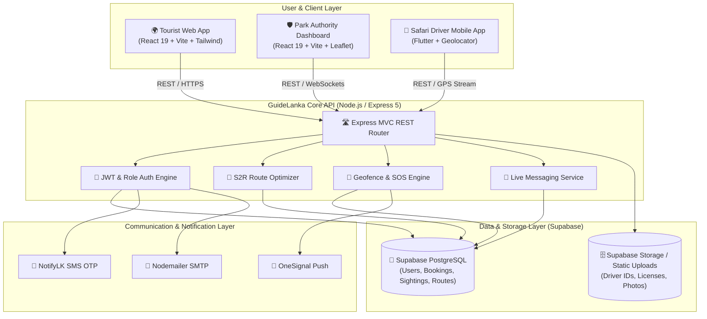

# 🌿 GuideLanka — Smart National Park & Wildlife Safari Management System

<div align="center">

[](https://nodejs.org/)
[](https://expressjs.com/)
[](https://react.dev/)
[](https://flutter.dev/)
[](https://supabase.com/)
[](https://tailwindcss.com/)
[](https://vitejs.dev/)
[](https://leafletjs.com/)

<p align="center">
  <b>A unified, intelligent ecosystem modernizing Sri Lanka's wildlife safari operations.</b><br>
  Connecting Tourists, Safari Drivers, and Department of Wildlife Conservation (DWC) Authorities through real-time GIS tracking, AI-assisted route optimization (S2R), instant emergency response, and verified bookings.
</p>

[Key Features](#-key-features) •
[Architecture](#-system-architecture) •
[S2R Algorithm](#-s2r-sightings-to-route-algorithm) •
[Modules](#-system-modules) •
[Quick Start](#-installation--setup-guide) •
[API Reference](#-api-endpoints-overview)

---

</div>

## 📖 Overview

National Parks in Sri Lanka (such as **Yala**, **Wilpattu**, **Udawalawe**, and **Minneriya**) host some of the world's highest densities of leopards, elephants, and endemic wildlife. However, modern safari tourism faces critical operational hurdles:
- **Track Congestion & Animal Disturbance**: Excessive vehicle crowding around sudden wildlife sightings.
- **Safety & Geofencing**: Safari vehicles accidentally straying into strict natural reserves or buffer zones.
- **Unverified Operators**: Lack of standardized driver credential verification and fair booking mechanisms for tourists.
- **Emergency Gaps**: Delay in SOS dispatch during mechanical failures or wildlife encounters.

**GuideLanka** solves these challenges by combining four tightly integrated applications powered by real-time GPS telemetry, push notifications, and multi-objective routing algorithms.

---

## 🏛️ System Architecture



---

## 🧠 S2R (Sightings-to-Route) Algorithm

At the core of the system is the **S2R Algorithm**, designed to simultaneously maximize visitor sighting potential while preventing wildlife harassment and track overcrowding:

$$\text{S2R Score} = (S_{\text{recency}} \times 0.5) - (C_{\text{density}} \times 0.3) - (D_{\text{travel}} \times 0.2)$$

Where:
* **$S_{\text{recency}}$**: Freshness weight of logged wildlife sightings along the segment.
* **$C_{\text{density}}$**: Live vehicle count currently occupying the track segment.
* **$D_{\text{travel}}$**: Distance calculated via the Great-Circle (Haversine) metric between current GPS coordinates and destination waypoint:

$$d = 2R \arcsin \left(\sqrt{\sin^2\left(\frac{\Delta \phi}{2}\right) + \cos(\phi_1)\cos(\phi_2)\sin^2\left(\frac{\Delta \lambda}{2}\right)}\right)$$

---

## 🚀 Key Features & Sub-Modules

### 1. 🛡️ Park Authority Command Dashboard (`/authority-dashboard`)
Designed for park rangers, wildlife wardens, and administrative authorities:
* **Live GIS Tracking Map**: Real-time visualization of all active safari jeeps, recent animal coordinates, restricted core zones, and track lines.
* **SOS & Emergency Incident Center**: Instant popup alerts upon SOS trigger, with 1-click GPS lock and ranger dispatch.
* **Geofence Enforcement**: Visual breach alerts whenever a vehicle enters protected block zones (e.g., Yala Block 5).
* **Driver Licensing & Compliance**: Review driver identities, commercial licenses, insurance records, and vehicle approvals.
* **Tourist & Visitor Analytics**: Historical and live charts for visitor traffic, busy gates, and peak safari hours.
* **Revenue Tracker**: Track park entry fees, safari commissions, and driver payments.
* **Dark / Light Mode**: Sleek command-center interface optimized for field operations.

### 2. 🌍 Tourist Web Experience (`/tourist-web-app`)
A responsive web platform for domestic and international travelers:
* **Wildlife Explorer & Sighting Heatmap**: Real-time pins of elephants, leopards, sloth bears, birds, and marine life.
* **Verified Driver Directory**: Browse certified safari drivers with real user reviews, languages spoken, jeep models, and pricing.
* **Seamless Safari Booking**: Request customized half-day, full-day, or multi-track safari excursions.
* **Live Driver Chat**: In-app messaging for pickup coordination and inquiries.
* **Park Guidelines & Safety Manual**: Interactive guides on park rules, dos & don'ts, photography tips, and wildlife ethics.
* **Multimedia Wildlife Gallery & FAQ**: High-resolution wildlife showcases and visitor support.

### 3. 📱 Safari Driver Mobile App (`/driver_mobile`)
A dedicated mobile application for field safari drivers built in Flutter:
* **Turn-by-Turn S2R Navigation**: Intelligently ranked trails avoiding congestions while targeting active animal areas.
* **Quick Wildlife Sighting Logger**: One-tap sighting reports with species tags and automated GPS stamping.
* **Panic SOS Button**: Emergency broadcast with exact vehicle coordinates sent instantly to the ranger control room.
* **Booking Dispatch Management**: Accept, reject, or manage incoming tourist bookings with trip itinerary tracking.
* **Driver Performance & Earnings**: Real-time summary of daily revenue, completed trips, and customer ratings.
* **Direct Tourist Chat**: Instant messaging with assigned passengers.

### 4. ⚙️ Central API & Backend Engine (`/backend`)
* **RESTful MVC Architecture**: Scalable, modular Node.js/Express service.
* **Database & Auth**: Supabase PostgreSQL with JWT role-based access control (`AUTHORITY`, `DRIVER`, `TOURIST`).
* **Multi-Channel Alerts**: SMS OTP verification via NotifyLK, push notifications via OneSignal, and confirmation emails via Nodemailer.
* **Static Storage**: Handles photo verification, avatar uploads, and document attachments.

---

## 📂 Repository Structure

```
GuideLanka-System/
├── 📁 authority-dashboard/      # React 19 + Vite Authority Management Dashboard
│   ├── 📁 src/
│   │   ├── 📁 components/       # LiveMap, SOSPanel, DriverReviewList, RevenueTracker, etc.
│   │   ├── 📁 pages/            # Dashboard, Login
│   │   └── 📁 services/         # Supabase client & API services
│   ├── package.json
│   └── vite.config.js
│
├── 📁 backend/                  # Node.js / Express 5 MVC REST API
│   ├── 📁 src/
│   │   ├── 📁 config/           # Supabase & environment configurations
│   │   ├── 📁 controllers/      # Auth, Alert, Booking, Driver, Sighting, Route controllers
│   │   ├── 📁 middlewares/      # JWT authentication & role-checker middlewares
│   │   ├── 📁 routes/           # REST endpoints definition
│   │   ├── 📁 services/         # S2R routing algorithm & notification services
│   │   └── 📁 utils/            # Helper utilities
│   ├── 📁 scripts/              # Database migration & schema validation scripts
│   ├── server.js                # Server entry point
│   └── package.json
│
├── 📁 driver_mobile/            # Cross-Platform Flutter Mobile App
│   ├── 📁 lib/
│   │   ├── 📁 screens/          # Home, Map, Emergency SOS, Chat, Profile, Bookings
│   │   ├── 📁 services/         # GPS Geolocator, API client, OneSignal handler
│   │   ├── 📁 widgets/          # Custom mobile UI components
│   │   └── main.dart            # Flutter application entry point
│   ├── 📁 assets/               # App icons & static visual assets
│   └── pubspec.yaml
│
├── 📁 tourist-web-app/          # React 19 + Vite Tourist Portal
│   ├── 📁 src/
│   │   ├── 📁 components/       # Navigation, Footer, Modals, Cards, Maps
│   │   ├── 📁 pages/            # Home, DriversList, Booking, LiveMap, ParkRules, Chat
│   │   └── 📁 services/         # API integration services
│   ├── package.json
│   └── vite.config.js
│
└── README.md                    # Project documentation
```

---

## 🛠️ Technology Stack

| Domain | Technology / Library | Purpose |
| :--- | :--- | :--- |
| **Backend Runtime** | Node.js (v20+), Express.js (v5.x) | Core REST API backend & micro-controllers |
| **Database & Auth** | Supabase (PostgreSQL), JWT, Bcrypt | Relational storage, user authentication, policies |
| **Authority UI** | React 19, Vite, Tailwind CSS v4, Lucide Icons | Responsive command-center dashboard |
| **Tourist Web UI** | React 19, Vite, Tailwind CSS v4 | Interactive visitor portal & booking interface |
| **Mobile App** | Flutter (Dart), `geolocator`, `flutter_map` | Cross-platform mobile driver application |
| **GIS & Mapping** | Leaflet, React-Leaflet, OpenStreetMap | Interactive spatial layers, geofences, vehicle GPS |
| **Notifications** | OneSignal, NotifyLK SMS, Nodemailer | Real-time push, OTP verification, booking emails |

---

## ⚡ Installation & Setup Guide

### Prerequisites
- **Node.js** (v18.x or v20+ recommended) & `npm`
- **Flutter SDK** (v3.10+ recommended) & **Android Studio / Xcode**
- **Git**
- A **Supabase** account with PostgreSQL database provisioned

---

### 1. Clone the Repository
```bash
git clone https://github.com/your-username/GuideLanka-System.git
cd GuideLanka-System
```

---

### 2. Backend Setup (`/backend`)
```bash
cd backend
npm install
```

Create a `.env` file based on `.env.example`:
```env
PORT=5000
SUPABASE_URL=https://your-supabase-project.supabase.co
SUPABASE_KEY=your-supabase-service-or-anon-key
JWT_SECRET=your_jwt_super_secret_key

# SMS OTP (NotifyLK)
SMS_PROVIDER=notifylk
NOTIFY_API_KEY=your_notifylk_api_key
NOTIFY_USER_ID=your_notifylk_user_id
NOTIFY_SENDER_ID=your_sender_id

# Email (SMTP)
SMTP_HOST=smtp.gmail.com
SMTP_PORT=587
SMTP_USER=your_email@example.com
SMTP_PASS=your_email_app_password

# Push Notifications (OneSignal)
ONESIGNAL_APP_ID=your_onesignal_app_id
ONESIGNAL_REST_API_KEY=your_onesignal_rest_key
```

Run in development mode:
```bash
npm run dev
# Backend runs on http://localhost:5000 (accessible on 0.0.0.0 for mobile testing)
```

---

### 3. Authority Dashboard Setup (`/authority-dashboard`)
```bash
cd ../authority-dashboard
npm install
npm run dev
# Dashboard opens on http://localhost:5173
```

---

### 4. Tourist Web App Setup (`/tourist-web-app`)
```bash
cd ../tourist-web-app
npm install
npm run dev
# Tourist portal runs on http://localhost:5174
```

---

### 5. Driver Mobile App Setup (`/driver_mobile`)
```bash
cd ../driver_mobile
flutter pub get

# Run on connected Android / iOS device or emulator
flutter run
```

---

## 📡 API Endpoints Overview

| Method | Endpoint | Description | Protected |
| :--- | :--- | :--- | :---: |
| `POST` | `/api/auth/register` | Register new Tourist or Safari Driver | No |
| `POST` | `/api/auth/login` | Authenticate user & issue JWT token | No |
| `POST` | `/api/auth/verify-otp` | Verify phone number via SMS OTP code | No |
| `GET` | `/api/driver/all` | List all verified safari drivers | Yes |
| `GET` | `/api/driver/:id` | Fetch specific driver details & ratings | Yes |
| `PUT` | `/api/driver/status` | Update driver availability (Online / On-Safari / Offline) | Yes |
| `GET` | `/api/sightings/active` | Get recent verified animal sightings (last 2 hours) | Yes |
| `POST` | `/api/sightings/log` | Driver logs a new animal sighting with GPS coordinates | Yes |
| `POST` | `/api/bookings/create` | Tourist creates a new safari reservation | Yes |
| `PUT` | `/api/bookings/:id/status`| Accept / Decline / Complete booking | Yes |
| `POST` | `/api/alerts/sos` | Trigger emergency SOS alert to Authority Dashboard | Yes |
| `POST` | `/api/alerts/location` | Stream driver live GPS coordinates | Yes |
| `GET` | `/api/chat/:bookingId` | Retrieve chat message history between tourist & driver | Yes |
| `POST` | `/api/chat/send` | Send a new chat message | Yes |

---

## 🔒 Security & Conservation Standards

- **Geofence Enforcement**: Automated spatial queries detect if any vehicle breaches sensitive core breeding habitats, triggering an audible visual warning on the Authority Dashboard.
- **Role-Based Access Control (RBAC)**: Strict separation of privileges between `AUTHORITY`, `DRIVER`, and `TOURIST` roles via signed JWT tokens.
- **Encrypted Credentials**: Passwords stored using salted `bcryptjs` hashes.
- **Eco-Compliance**: Strict route load balancing to adhere to Sri Lanka Department of Wildlife Conservation (DWC) track saturation ceilings.

---

## 👥 Contributors & Acknowledgements

Developed as a modern wildlife technology initiative to advance sustainable eco-tourism in Sri Lanka.
Special thanks to the local safari drivers and wildlife conservationists whose domain feedback shaped the S2R algorithm and emergency response workflows.

---

<div align="center">
  <sub>Built with ❤️ for Sri Lanka's Wildlife & National Parks.</sub>
</div>
